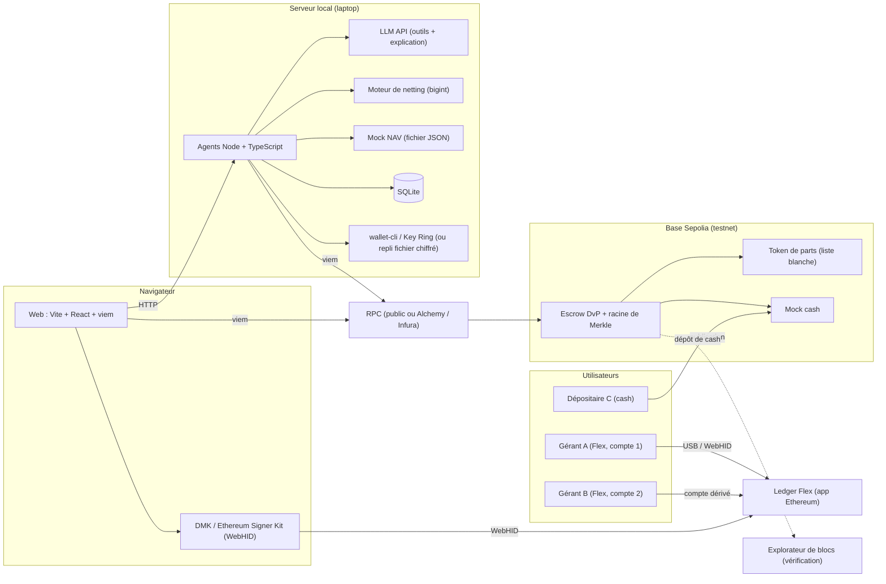
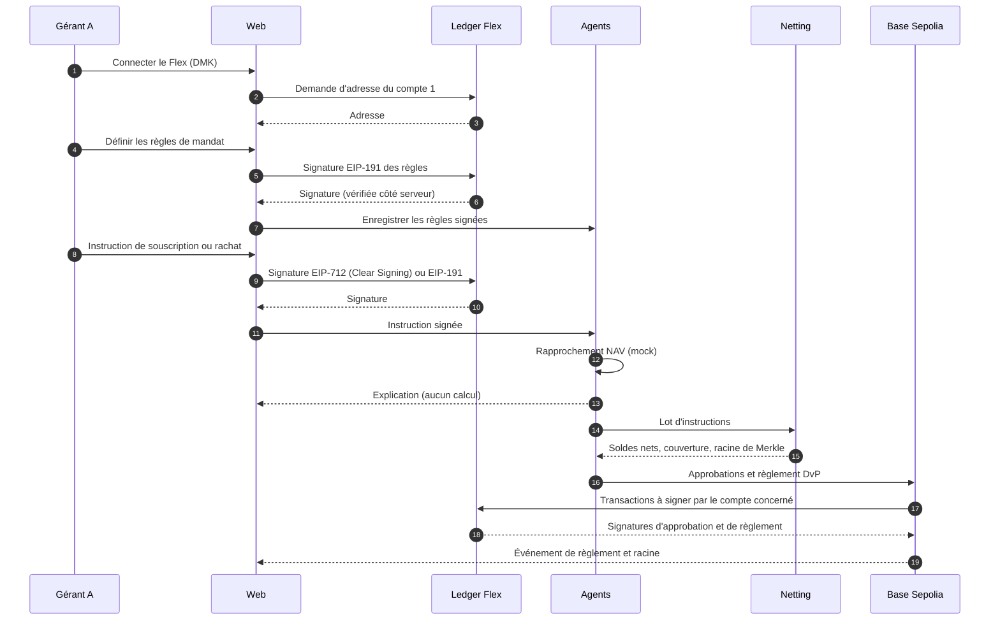

# Diagramme technique et actions manuelles : POC netting pré-financé

Date : 10 octobre 2026. Document de travail, à lire avec `spec-poc.md`.

Les noms de paquets, commandes et menus ci-dessous sont à vérifier au moment de l'installation : je les ai écrits de mémoire et je ne les ai pas testés.

## 1. Vue d'ensemble

## 2. Séquence d'une démo complète

## 3. Actions manuelles, par outil

Chaque ligne est une action que tu dois faire toi-même, avec le moment où elle est nécessaire. Les cases sont à cocher au fur et à mesure.

### Ledger

| Statut | Action | Quand | Détail |
|---|---|---|---|
| [ ] | Mettre à jour le firmware du Flex | Avant lundi | Via Ledger Live |
| [ ] | Installer l'application Ethereum sur le Flex | Avant lundi | Via Ledger Live, Gestionnaire d'applications |
| [ ] | Créer les trois comptes du POC (A, B, C) sur le Flex | Avant lundi | Dans Ledger Live, un compte par participant. Noter les adresses. |
| [ ] | Décider : un seul Flex ou un second pour le gérant B | Lundi matin | Voir la question 2 de `spec-poc.md` |
| [ ] | Lancer le test Clear Signing EIP-712 avec un message minimal | Lundi matin, en premier | Noter si le rendu est lisible |
| [ ] | Vérifier les conditions d'utilisation de DMK et du SDK Ledger | Avant la démo publique | Redistribution et usage hackathon |
| [ ] | Tester la connexion WebHID depuis Chrome | Lundi | Navigateur et site en HTTPS ou localhost |

### Base Sepolia et wallets de test

| Statut | Action | Quand | Détail |
|---|---|---|---|
| [ ] | Créer un wallet déployeur (clé de test) | Dim 11 | Hors Flex, uniquement pour le testnet |
| [ ] | Créer un wallet agent (clé de test) | Dim 11 | Uniquement pour les frais de gaz |
| [ ] | Obtenir de l'ETH de test via un faucet Base Sepolia pour chaque wallet | Dim 11 | Certains faucets demandent un compte ou limitent les quantités |
| [ ] | Envoyer du mock cash et des parts aux adresses A, B, C | Dim 11 | Après déploiement des contrats |
| [ ] | Déployer les contrats avec Foundry | Dim 11 | Commandes à vérifier dans la doc Foundry |
| [ ] | Vérifier les contrats sur l'explorateur (Basescan) | Lun 12 | Demande une clé API gratuite |
| [ ] | Noter les adresses publiques dans le README | Mar 13 | Pour que le jury puisse vérifier |

### Services externes

| Statut | Action | Quand | Détail |
|---|---|---|---|
| [ ] | Créer un compte chez un fournisseur de LLM | Avant dimanche | Générer une clé de test avec un plafond de dépense |
| [ ] | Choisir le RPC : public ou compte Alchemy / Infura | Dim 11 | Plan gratuit à vérifier, le RPC public peut suffire |
| [ ] | Créer un compte Basescan et une clé API | Lun 12 | Pour la vérification des contrats |
| [ ] | Installer et tester wallet-cli sur les postes de l'équipe | Lundi matin, en second | Si échec : repli sur fichier chiffré local |

### Poste de travail

| Statut | Action | Quand | Détail |
|---|---|---|---|
| [ ] | Installer Node LTS, pnpm ou npm | Dim 11 | Versions à vérifier |
| [ ] | Installer Foundry (foundryup) | Dim 11 | Commande à vérifier dans la doc officielle |
| [ ] | Installer Git et configurer les accès au repo | Dim 11 | Repo `N3XT-Hackathon-26` |
| [ ] | Créer les fichiers `.env` locaux, exclus du dépôt | Dim 11 | Clés de test, clé LLM, clé Basescan, RPC |
| [ ] | Vérifier que `.gitignore` exclut `.env` et les clés | Dim 11 | Avant le premier commit |

### Équipe et décisions

| Statut | Action | Quand | Détail |
|---|---|---|---|
| [ ] | Trancher : POC seul, ou POC et copilote BTC | Sam 10 ou Dim 11 | Décision à consigner dans DECISIONS.md |
| [ ] | Vérifier les règles du hackathon sur les nouveaux projets | Dim 11 | Voir question 3 de `spec-poc.md` |
| [ ] | Décider si `clearing-house-web3/` reste dans le repo public | Avant la mise en public | Voir la remarque sur le repo |
| [ ] | Préparer la vidéo de secours | Mar 13 | Enregistrement du scénario complet |
| [ ] | Préparer la démo en direct et la répétition | Mer 14 - Jeu 15 | Deux répétitions minimum |

## 4. Ce que l'agent et le code font, pour référence

Les actions ci-dessus sont les seules qui demandent ton intervention. Tout le reste est écrit par l'équipe ou généré : contrats Solidity, tests Foundry, moteur de netting, serveur agents, interface web, mock NAV, intégration DMK. Le LLM n'intervient jamais sur un calcul ou une transaction.

## 5. Points de vigilance

- Aucune clé de production. Les clés du POC ne servent que sur testnet.
- Aucun secret dans le dépôt. Les `.env` restent locaux.
- Si Clear Signing EIP-712 ne marche pas lundi, le repli EIP-191 est activé sans changer l'architecture.
- Si wallet-cli ne s'installe pas, le repli fichier chiffré local est activé.
