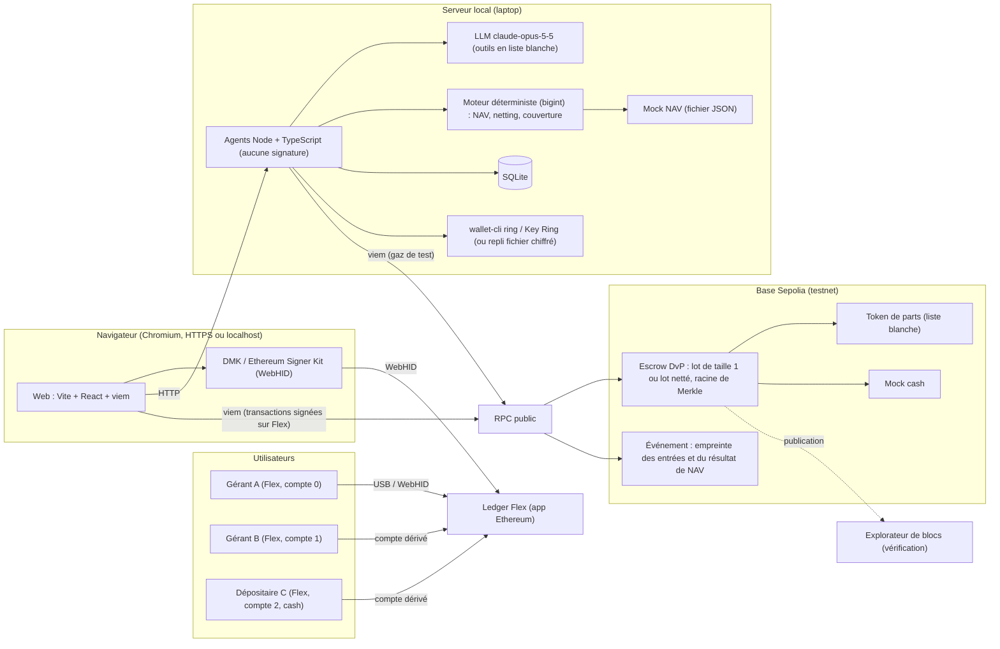
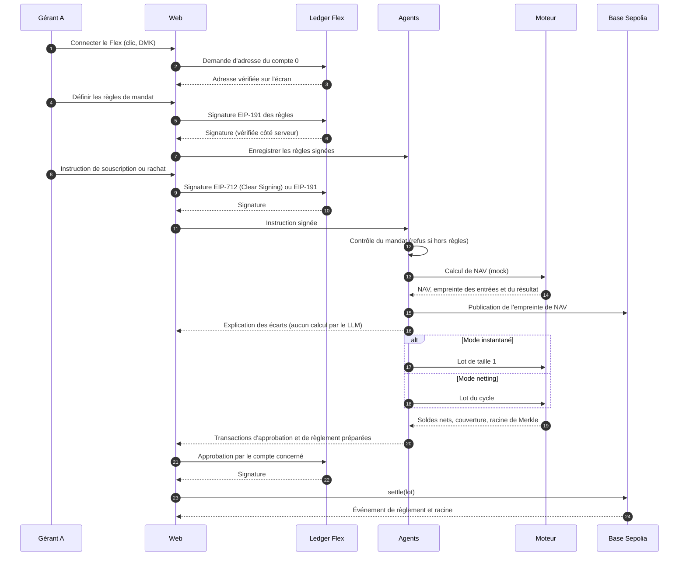

# Diagramme technique et actions manuelles : POC de règlement DvP à deux modes

Date : 10 octobre 2026, mis à jour le 11 octobre 2026. Document de travail, à lire avec `spec-poc.md` et `stories/README.md`.

Les paquets Ledger (DMK, signer Ethereum, context-module, wallet-cli) ont été vérifiés dans la documentation et le dépôt `LedgerHQ/agent-skills`. Les commandes Foundry et Basescan restent à vérifier au moment de l'installation.

## 1. Vue d'ensemble

Le wallet de gaz de l'agent ne publie que l'empreinte de NAV, qui n'ajoute aucun risque. Les règlements sont approuvés sur le Flex (recommandation Q-07).

## 2. Séquence d'une démo complète

## 3. Actions manuelles, par ordre d'exécution

Chaque ligne est une action à faire soi-même. La colonne « Phase » suit l'ordre d'exécution de `stories/README.md` : 1 débloquer, 2 contrats et netting, 3 signatures, 4 agents, 5 interface, 6 démo et soumission.

### Ledger

| Statut | Action | Phase | Story | Détail |
|---|---|---|---|---|
| [ ] | Mettre à jour le firmware du Flex | 1 | S-005 | Via Ledger Wallet (ex-Ledger Live) |
| [ ] | Installer l'app Ethereum sur le Flex | 1 | S-005 | Via le gestionnaire d'applications |
| [ ] | Tester la connexion WebHID depuis Chrome | 1 | S-005 | HTTPS ou localhost, appel sur un clic |
| [ ] | Lancer le test Clear Signing EIP-712 | 1, en premier | S-006 | Noter si le rendu est lisible. Sinon repli EIP-191 |
| [ ] | Demander un `originToken` sur Discord | 1 | S-006 | Conditionne peut-être le Clear Signing (Q-02) |
| [ ] | Dériver et noter les adresses A, B, C | 1 | S-007 | Chemins `44'/60'/n'/0/0`, sans préfixe `m/` |
| [ ] | Installer l'app Ledger Sync sur le Flex | 1 | S-008 | Nécessaire pour `ring init`. Sinon repli fichier chiffré |
| [ ] | Installer wallet-cli et lancer `ring init` | 1 | S-008 | Mot de passe via le trousseau, jamais en clair |
| [ ] | Lire les conditions d'utilisation de wallet-cli | 6 | Q-11 | Avant la vidéo publique |

### Base Sepolia et wallets de test

| Statut | Action | Phase | Story | Détail |
|---|---|---|---|---|
| [ ] | Créer un wallet déployeur (clé de test) | 2 | S-014 | Hors Flex, uniquement pour le testnet |
| [ ] | Créer un wallet agent (clé de test) | 2 | S-014 | Uniquement pour le gaz et la publication d'empreintes |
| [ ] | Obtenir de l'ETH de test pour chaque wallet | 2 | S-014 | Faucet Alchemy : 0,1 ETH par 24 h et par adresse, avec un solde minimal de 0,001 ETH sur Ethereum mainnet. Faucet Blast API à éviter |
| [ ] | Déployer les contrats avec Foundry | 2 | S-014 | Commandes à vérifier dans la doc Foundry |
| [ ] | Vérifier les contrats sur Basescan | 2 | S-014 | Clé API gratuite |
| [ ] | Envoyer du mock cash et des parts à A, B, C | 2 | S-010 | Après déploiement |
| [ ] | Noter les adresses publiques dans le README | 6 | S-037 | Pour que le jury puisse vérifier |

### Services externes

| Statut | Action | Phase | Story | Détail |
|---|---|---|---|---|
| [ ] | Créer une clé Anthropic de test | 4 | S-029 | Console Anthropic, `claude-opus-5-5` recommandé (Q-01) |
| [ ] | Poser le plafond de dépense | 4 | S-029 | 50 $ proposés, alerte à 25 $, à confirmer dans la Console |
| [ ] | Créer une clé API Basescan | 2 | S-014 | Pour la vérification des contrats |

### Poste de travail

| Statut | Action | Phase | Story | Détail |
|---|---|---|---|---|
| [ ] | Installer Node LTS et pnpm ou npm | 1 | S-030 | Versions à vérifier |
| [ ] | Installer Foundry (`foundryup`) | 1 | S-013 | Commande à vérifier dans la doc officielle |
| [ ] | Créer les `.env` locaux, exclus du dépôt | 1 | S-004 | Clés de test, clé LLM, clé Basescan, RPC |
| [ ] | Vérifier que `.gitignore` exclut `.env` et les clés | 1 | S-004 | Avant le premier commit |

### Équipe et décisions

| Statut | Action | Phase | Story | Détail |
|---|---|---|---|---|
| [ ] | Trancher : POC seul comme soumission | 1 | S-002 | Une seule soumission par équipe (Q-04) |
| [ ] | Dater le copilote BTC et le déclarer si besoin | 1 | S-001 | Q-05 |
| [ ] | Décider de l'accès du jury au dépôt | 6 | S-039 | Public ou accès explicite (Q-13) |
| [ ] | Enregistrer la vidéo de secours | 6 | S-036 | Scénario complet, les deux modes |
| [ ] | Répéter la démo deux fois | 6 | S-040 | Chronomètre, questions probables |

## 4. Ce que l'agent et le code font, pour référence

Les actions ci-dessus sont les seules qui demandent une intervention humaine. Tout le reste est écrit par l'équipe ou généré : contrats Solidity, tests Foundry, moteur de NAV et de netting, serveur agents, interface web, mock NAV, intégration DMK. Le LLM n'intervient jamais sur un calcul ou une transaction.

## 5. Points de vigilance

- Aucune clé de production. Les clés du POC ne servent que sur testnet.
- Aucun secret dans le dépôt. Les `.env` restent locaux.
- Une seule commande sur le Flex à la fois : deux opérations en parallèle corrompent l'échange.
- Si le Clear Signing EIP-712 n'est pas concluant, le repli EIP-191 est activé sans changer l'architecture.
- Si wallet-cli ou l'app Ledger Sync ne s'installent pas, le repli fichier chiffré local est activé.
